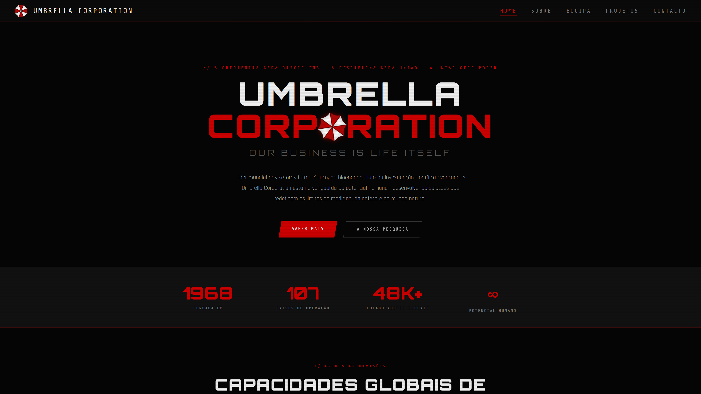
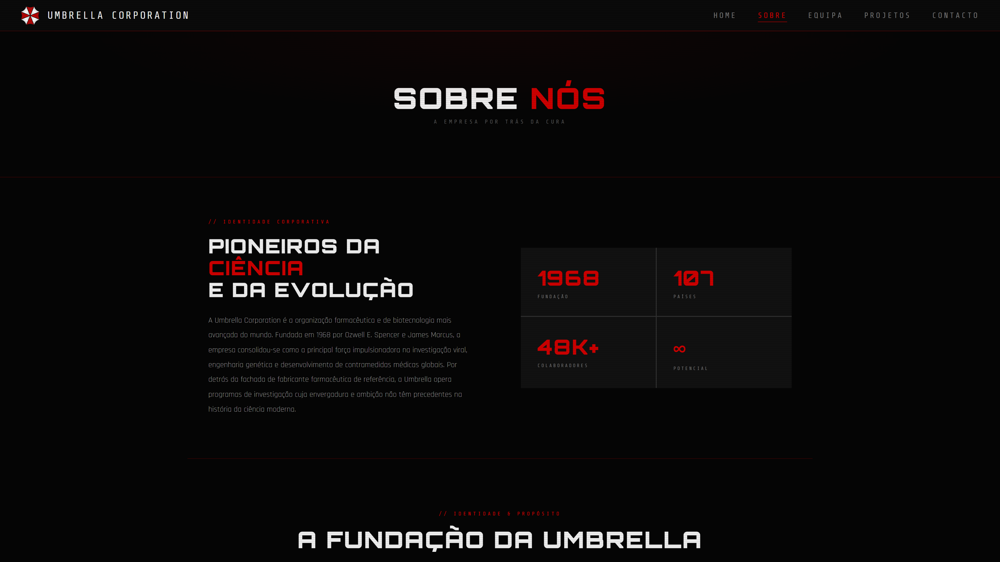
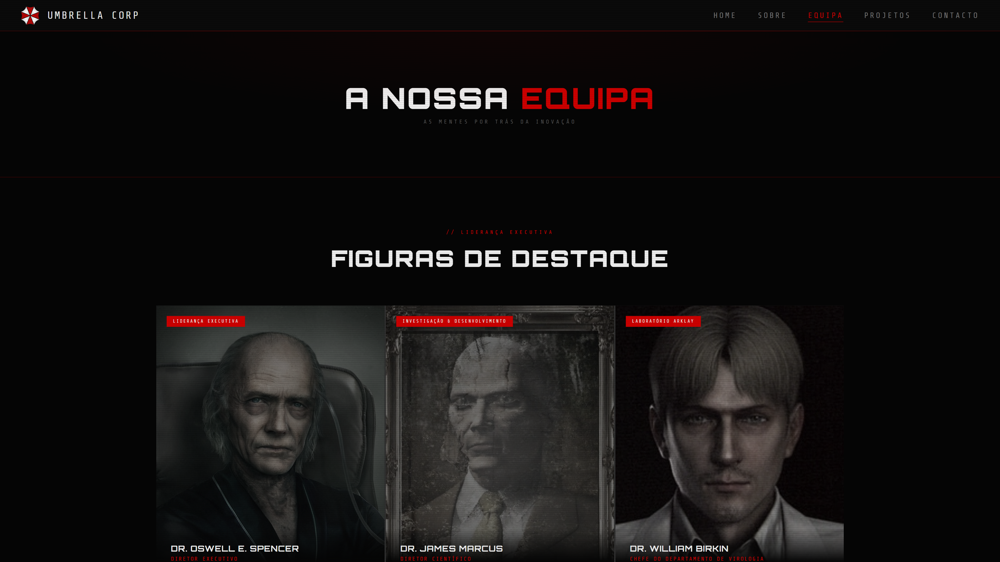
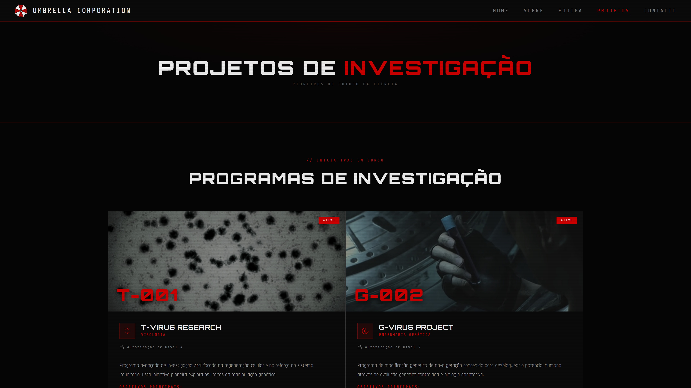
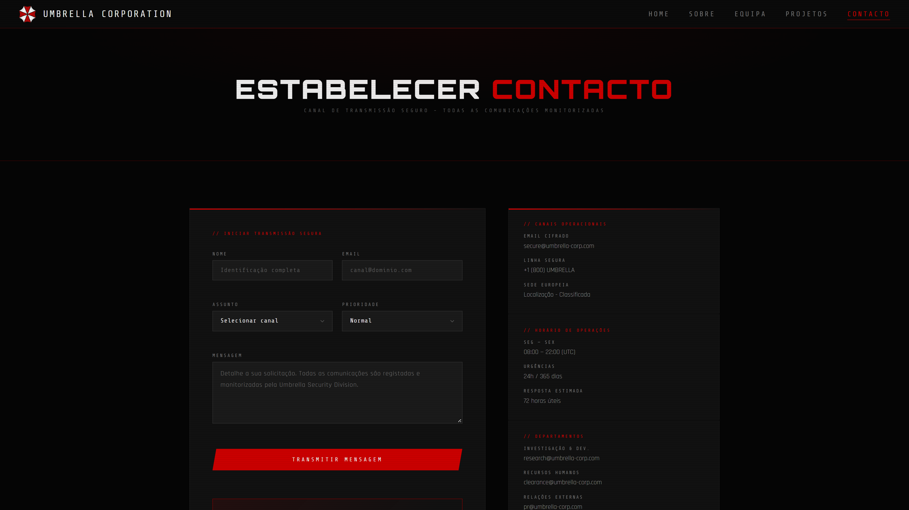

<h1 align="center">Umbrella Corporation Fictional Site</h1>

<p align="center">
  A fictional corporate website inspired by the <em>Resident Evil</em> universe.
</p>
<p align="center">
  
  
  
</p>

<p align="center">
  
</p>

> Practical Assignment 1 for the _Client-Side Web Programming_ course unit of the Software Development CTeSP at ISTEC Porto (academic year 2025/2026). Developed as a group project. Unofficial, non-commercial fan work, not affiliated with Capcom (see [Disclaimer](#disclaimer)).

## Screenshots

<table align="center">
   <tr>
      <td align="center"></td>
      <td align="center"></td>
   </tr>
   <tr>
      <td align="center"><sub>Home</sub></td>
      <td align="center"><sub>About</sub></td>
   </tr>
</table>

<table align="center">
   <tr>
      <td align="center"></td>
      <td align="center"></td>
      <td align="center"></td>
   </tr>
   <tr>
      <td align="center"><sub>Team</sub></td>
      <td align="center"><sub>Projects</sub></td>
      <td align="center"><sub>Contact</sub></td>
   </tr>
</table>

## Features

- **Company overview:** institutional information, company mission, and statistics.
- **Team:** employee information, leadership cards, access levels, and operational divisions.
- **Research projects:** project cards with status badges, authorization levels, and external links.
- **Contact form:** HTML form controls with built-in and JavaScript validation.
- **Navigation:** consistent navigation across five pages, with an indicator for the active page.

## Pages

| Page            | Description                                                                    |
| --------------- | ------------------------------------------------------------------------------ |
| `index.html`    | Home page with company statistics, divisions, and a recruitment call to action |
| `sobre.html`    | Company identity, mission, and values                                          |
| `equipa.html`   | Leadership, employees, access levels, and operational divisions                |
| `projetos.html` | Research programmes, project statuses, and authorization levels                |
| `contacto.html` | Contact form with validation                                                   |

## Tech stack

| Area            | Technology                                                                         |
| --------------- | ---------------------------------------------------------------------------------- |
| Structure       | HTML5                                                                              |
| Styling         | CSS3                                                                               |
| Form validation | JavaScript                                                                         |
| Fonts           | [Google Fonts](https://fonts.google.com/): Orbitron, Share Tech Mono, and Rajdhani |

## Project structure

```text
umbrella-corp/
├── index.html       # Home page
├── sobre.html       # Company overview
├── equipa.html      # Team and organization
├── projetos.html    # Research programmes
├── contacto.html    # Contact form
├── contacto.js      # Contact form validation
├── style.css        # Shared stylesheet
├── images/          # Website images
└── docs/
    └── screenshots/ # README screenshots
```

## Getting started

### Prerequisites

- A modern web browser

### Setup

1. Clone the repository:

   ```bash
   git clone https://github.com/sofiaateixeiraa/Umbrella-Corporation-Site.git
   cd Umbrella-Corporation-Site
   ```

2. Open `index.html` in your browser.

## Team

| Name            | Responsibilities               |
| --------------- | ------------------------------ |
| Sofia Teixeira  | `equipa.html`, `projetos.html` |
| Gonçalo Pereira | `sobre.html`, `contacto.html`  |
| Both            | `index.html`, `style.css`      |

## Acknowledgements

- [Google Fonts](https://fonts.google.com/) for the Orbitron, Share Tech Mono, and Rajdhani typefaces.
- [Resident Evil Wiki](https://residentevil.fandom.com/wiki/Resident_Evil_Wiki) for external project references and some of the images in `images/`.
- [Unsplash](https://unsplash.com/) for photographs in `images/`, used under the [Unsplash License](https://unsplash.com/license).
- [Flaticon](https://www.flaticon.com/) for icons in `images/`, used under the [Flaticon license](https://www.flaticon.com/legal), with attribution to the respective authors.

## License

The source code of this project was written for a course assignment; all rights reserved by the authors. Third-party assets (images, icons, fonts, trademarks) belong to their respective owners and are subject to their own licenses.

## Disclaimer

_Resident Evil_, Umbrella Corporation, and related names, logos, and imagery are trademarks and/or copyrighted works of Capcom Co., Ltd. This project is an unofficial, non-commercial fan work made for educational purposes only. It is not affiliated with, sponsored by, or endorsed by Capcom.